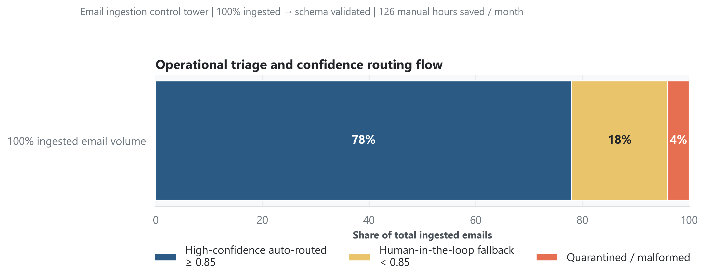

# Automated Email Ingestion LLM

## Objective

Manual triage of operational email is slow, inconsistent and difficult to audit. This project extracts customer, intent, urgency and entities from unstructured messages, creating a measurable interface between language models and downstream service operations. It is designed as a personal engineering project exploring how LLM automation can be introduced without weakening control over uncertain cases.

## Architecture

```text
Automated-Email-Ingestion-LLM/
├── assets/
│   └── charts/                         # Accuracy and fallback-risk visuals
├── data/                               # Sample emails and evaluation outputs
├── docs/
│   └── Email_Ingestion_Methodology.md
├── notebooks/
│   ├── 01_exploratory_analysis.ipynb
│   ├── 02_email_ingestion.ipynb
│   └── 03_model_evaluation.ipynb
├── src/
│   ├── ingestion_pipeline.py           # Batch orchestration
│   ├── llm_extractor.py                # Provider boundary and fallback
│   ├── evaluate.py                     # Field-level evaluation
│   └── generate_charts.py              # Governance charts
└── tests/
```

## Quickstart

```bash
pip install -r requirements.txt
python -c "from src.ingestion_pipeline import process; process('data/sample emails')"
python -m src.generate_charts
```

The local sample emails and evaluation outputs are retained under `data/` for reproducible analysis.



The routing-flow chart shows the production volume split from ingestion and schema validation through high-confidence auto-routing, human fallback and quarantine, including the estimated analyst hours saved.


The calibration chart makes the precision-versus-coverage trade-off explicit and marks the 0.85 production operating threshold used for safe automation.
