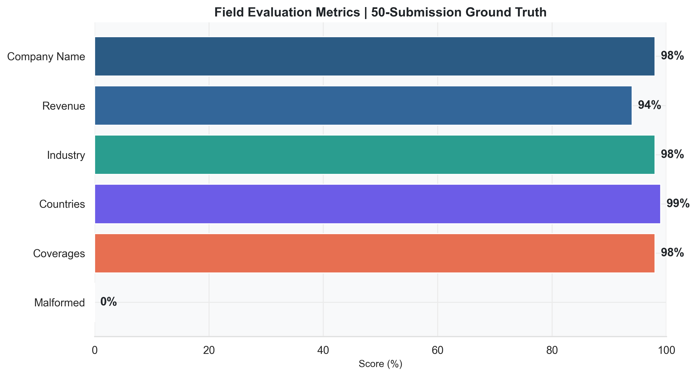
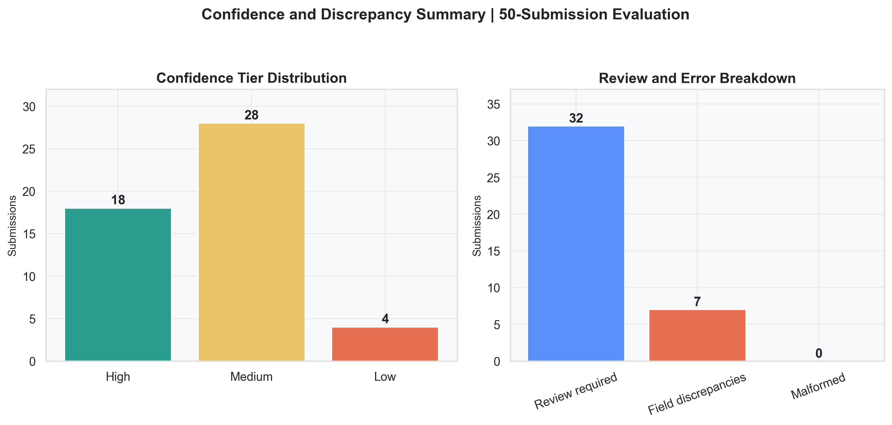

# Automated Email Ingestion LLM

## Objective

This repository implements an insurance underwriting multi-document email extraction pipeline. It groups broker email and attachment Markdown files by submission ID, uses a constrained Groq LLM to extract underwriting fields, applies deterministic confidence and review rules, and evaluates structured output against a 50-submission ground-truth dataset. The target output covers company identity, actual revenue, operating countries, industry, requested coverages, confidence, review reasons and evidence-based explanations.

## Performance Summary

| Field | Real 50-Submission Score |
| :--- | ---: |
| Company Name | 98% |
| Revenue | 94% |
| Industry | 98% |
| Countries Macro F1 | 99% |
| Requested Coverages Macro F1 | 98% |
| Malformed / Failed Record Rate | 0% |

The seven-record discrepancy analysis, including projected revenue, incidental countries, and conflicting company naming, is documented in [Email Ingestion Methodology](docs/Email_Ingestion_Methodology.md).

## Architecture

```text
Automated-Email-Ingestion-LLM/
├── .github/
│   └── workflows/
│       └── ci.yml
├── assets/
│   └── charts/
│       ├── 01_field_evaluation_metrics.png
│       └── 02_confidence_and_error_breakdown.png
├── data/
│   ├── sample emails/                  # 50 grouped Markdown submissions
│   ├── ground_truth.csv
│   ├── llm_extracted_submissions.csv
│   └── evaluation_outputs/
├── docs/
│   └── Email_Ingestion_Methodology.md
├── notebooks/
│   ├── 01_exploratory_analysis.ipynb
│   ├── 02_email_ingestion.ipynb
│   └── 03_model_evaluation.ipynb
├── src/
│   ├── config.py                       # Centralised environment settings
│   ├── ingestion_pipeline.py           # Markdown grouping and batch orchestration
│   ├── llm_extractor.py                # Groq extraction and confidence rules
│   ├── evaluate.py                     # Exact, semantic and set-based evaluation
│   └── generate_charts.py              # Real-data publication charts
├── tests/
├── .env.example
└── requirements.txt
```

## Quickstart

```bash
python -m pip install -r requirements.txt
python -m src.ingestion_pipeline --data-dir "data/sample emails" --pause 3
python -m src.evaluate --ground-truth data/ground_truth.csv --predictions data/llm_extracted_submissions.csv --output-dir data/evaluation_outputs
python -m src.generate_charts
python -m pytest
```

Live extraction requires `GROQ_API_KEY` in `.env`; unit tests use mocked clients and make no live API calls.



The horizontal bars reproduce the real exact-match, semantic-match, macro-F1 and malformed-record scores from `data/evaluation_outputs/evaluation_metrics.csv`.



The chart shows actual confidence distributions, review-required records, field discrepancies and malformed-record counts from the 50-submission evaluation outputs.
